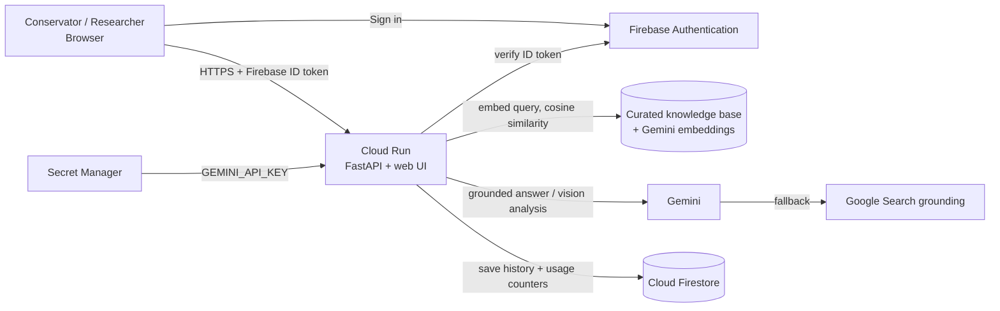

# 🏛️ HeritageLens AI

> **Google Cloud AI Builder Cup 2026** - *Sustainability & Social Impact Track*
> **Aligned with UN SDG 11.4** - *Strengthen efforts to protect and safeguard the world's cultural and natural heritage.*
> **Live prototype:** https://heritagelens-ai-93118475309.asia-southeast1.run.app

HeritageLens AI helps archaeological curators, architectural conservators and field preservationists in Pakistan make better-informed conservation decisions. It combines **citation-grounded literature search** with **photo-based surface-decay diagnostics**, so a conservator can ask *"Why is cement plaster harmful at Dharmarajika Stupa?"* or upload a photo of a wall and get a structured, charter-aligned assessment in seconds.

---

## The problem

Ancient masonry across Pakistan (Taxila, Moenjodaro, Takht-i-Bahi, Lahore Fort and many smaller sites) is deteriorating from salt attack, rising damp, biological growth and, most damagingly, **well-meant repairs with incompatible modern materials** such as Portland cement. Conservation guidance exists, but it is scattered across site management plans, UNESCO reports and international charters, and many field teams have no quick way to consult it or to triage what they see on site.

## Our approach: preserve the knowledge, not only the stones

Heritage is lost in two ways: the monuments decay, and the **knowledge about how to understand and care for them fades** as papers, reports and expert memory are scattered or forgotten. HeritageLens AI addresses both.

- **Published knowledge first.** Instead of answering from generic, AI-generated web text, the app answers conservation questions from a curated knowledge base of **published, citable documents** (site management plans, UNESCO conservation reports and charters), and shows the exact source, year and page it used. This makes it useful to researchers and academics, who need to know *where* a statement comes from.
- **A growing collective memory.** Each document added to the knowledge base becomes searchable, citable knowledge that the AI can draw on, so expertise is captured in one place instead of fading with time. The knowledge base is retrieval-based (the model is not retrained), so adding or correcting a source takes effect immediately and every answer stays traceable.
- **General heritage knowledge when the archive has no answer.** If a question falls outside the archive, the app answers through Google Search grounding and says clearly that it did so, so users always know whether an answer came from the curated archive or from the open web.

## What it does

### 1. Heritage questions and literature search (RAG)
- Your question is embedded with Google's Gemini embedding model and matched by **cosine similarity** against the curated knowledge base.
- **Archive answers (conservation questions):** if a close match is found (similarity ≥ `SIMILARITY_THRESHOLD`, default **0.65**), **Gemini** answers *only* from the retrieved excerpts, at temperature 0, with inline citations in the form `(Author, Year, p. Page)`. The top sources are shown beside the answer with their similarity scores. Example: *"How is salt damaging Moenjodaro and what conservation measures are used?"*
- **General heritage answers (everything else):** if the archive cannot answer, the app switches automatically to **Gemini with Google Search grounding**, labels the answer as live web search, and lists the sources it used. Example: *"Which language did the Buddha speak?"* or *"What are the accepted principles for preserving ancient masonry?"*

### 2. Field photo diagnostic (multimodal)
- Upload a photo of masonry, a relief or a facade. Gemini vision returns a structured report:
  - **Which place it is:** the probable monument, its **location** (district, province, country), its **historical significance**, heritage status, the visual clues behind the identification, a confidence level and alternative candidates.
  - **Condition:** architectural elements, stylistic period, and **surface degradation markers with severity ratings**.
  - **What to do and what to avoid:** **conservation guidance with explicit contraindications**, referenced to ICOMOS/UNESCO charters.
- Every report carries a scientific limitations disclaimer: this is a preliminary visual screen, not a substitute for core sampling, ultrasound or structural testing.

### 3. Saved history (Firebase)
- Users can **sign in with email/password or Google**. Their literature searches and photo diagnostics are saved to **Cloud Firestore** and shown in a **My History** tab.
- Guests can use the whole app without signing in; only history requires an account.

---

## How we use Firebase, Firestore, Cloud Run and Gemini

| Service | Role in HeritageLens AI |
| :--- | :--- |
| **Cloud Run** | Hosts the containerised FastAPI backend *and* serves the web UI from a single service in `asia-southeast1`. The Gemini key is mounted from Secret Manager. |
| **Gemini** (`gemini-3.1-flash-lite` via `google-generativeai`) | Grounded answer synthesis over retrieved excerpts, Google Search grounding for the web fallback, and multimodal vision analysis for photos. A model fallback chain keeps requests working if a model is unavailable. |
| **Gemini embeddings** (`gemini-embedding-001`, with fallbacks) | Vector search over the knowledge base. |
| **Firebase Authentication** | Email/password and Google sign-in on the web client. The backend verifies the Firebase ID token on each request. |
| **Cloud Firestore** | Stores each signed-in user's history at `users/{uid}/history`, and anonymous usage counters at `usage_stats/summary` (no query text). Accessed only from the backend using the Cloud Run service identity. |

### Architecture



### Data model (Firestore)

```text
users/{uid}                      email, name, last_seen
users/{uid}/history/{id}         type: "research" | "diagnostic", created,
                                 research:   query, mode, answer, similarity_score, source_count
                                 diagnostic: filename, primary_candidate, location, confidence,
                                             period, summary, markers[{name, severity}]
usage_stats/summary              total_research, total_diagnostic, updated
```

Uploaded photos are **not stored**; only the structured findings are saved.

---

## API

| Method | Endpoint | Auth | Description |
| :--- | :--- | :--- | :--- |
| `GET` | `/api/health` | none | Service status, model names, knowledge base size, `firestore_connected` |
| `POST` | `/api/research` | optional | Literature search (JSON body `{"query": "..."}`) |
| `POST` | `/api/analyze-image` | optional | Photo diagnostic (multipart `file`) |
| `GET` | `/api/history` | required | Signed-in user's last saved items (`Authorization: Bearer <Firebase ID token>`) |

"Optional" means the endpoint works for guests; if a valid Firebase ID token is sent, the result is also saved to the user's history.

### Quick tests

```bash
# Literature search
curl -X POST "https://heritagelens-ai-93118475309.asia-southeast1.run.app/api/research" \
     -H "Content-Type: application/json" \
     -d '{"query": "How can salt damage be mitigated at Mohenjo-daro?"}'

# Photo diagnostic
curl -X POST "https://heritagelens-ai-93118475309.asia-southeast1.run.app/api/analyze-image" \
     -F "file=@/path/to/heritage_site_photo.jpg"
```

The first returns `"mode": "archival_rag"` with a grounded answer, citations such as `(UNESCO World Heritage Committee, 2024, p. Decision 46 COM 7B.38)` and the retrieved sources. A question outside the knowledge base, such as *"Which language did the Buddha speak?"*, returns `"mode": "web_search_fallback"`.

---

## Project structure

```text
HeritageLens-AI/
├── backend/
│   ├── main.py                 # FastAPI app, RAG engine, Gemini vision, Firebase/Firestore integration
│   ├── requirements.txt
│   └── data/knowledge_base.json  # Curated conservation knowledge base
├── frontend/
│   └── index.html              # Web UI (Tailwind CSS, Firebase Auth web SDK)
├── Dockerfile                  # Container build for Cloud Run
├── .dockerignore
└── README.md
```

## Run locally

```bash
git clone https://github.com/Humna-AI/HeritageLens-AI.git
cd HeritageLens-AI

python -m venv .venv
source .venv/bin/activate          # Windows: .venv\Scripts\activate
pip install -r backend/requirements.txt

export GEMINI_API_KEY="your-gemini-api-key"      # Windows (cmd): set GEMINI_API_KEY=your-key
python -m uvicorn backend.main:app --reload --port 8080
```

Open http://localhost:8080. Search and photo diagnostics work with only a Gemini key. To also test history locally, run `gcloud auth application-default login` so the backend can reach Firestore; without it the app runs normally and simply skips saving.

Optional environment variables: `GEMINI_MODEL`, `SIMILARITY_THRESHOLD` (default `0.65`), `FIREBASE_PROJECT_ID` (default `heritagelens-ai-pk-2026`).

## Deploy to Google Cloud Run

```bash
# One-time: store the Gemini key in Secret Manager and allow the service to read it
echo -n "YOUR_GEMINI_API_KEY" | gcloud secrets create GEMINI_API_KEY --data-file=-
gcloud secrets add-iam-policy-binding GEMINI_API_KEY \
    --member="serviceAccount:93118475309-compute@developer.gserviceaccount.com" \
    --role="roles/secretmanager.secretAccessor"

# One-time: allow the service to use Firestore, and create the (default) database
gcloud projects add-iam-policy-binding heritagelens-ai-pk-2026 \
    --member="serviceAccount:93118475309-compute@developer.gserviceaccount.com" \
    --role="roles/datastore.user"
gcloud firestore databases create --location=asia-southeast1

# Build and deploy from source
gcloud run deploy heritagelens-ai \
    --source . \
    --region asia-southeast1 \
    --allow-unauthenticated \
    --timeout=300s \
    --set-secrets="GEMINI_API_KEY=GEMINI_API_KEY:latest"
```

In the Firebase console, enable the **Email/Password** and **Google** sign-in providers and add the Cloud Run domain under *Authentication → Settings → Authorized domains*.

---

## Limitations and responsible use

- **Preliminary screening only.** Photo analysis cannot assess internal structural stability, subsurface moisture, mortar condition at depth or seismic vulnerability, and does not replace on-site testing by qualified conservators.
- **Monument identification is probabilistic.** The app reports a confidence level and alternative candidates; results should be verified against site records.
- **Small seed knowledge base.** The curated corpus currently holds seven entries covering Taxila, Moenjodaro, Jamal Garhi, Takht-i-Bahi and Lahore Fort: UNESCO World Heritage List entries, two UNESCO Committee state-of-conservation decisions, and a scholarly essay from Oxford's Gandhara Connections project. Each entry is a condensed excerpt that links to its source; web pages are cited by the year they were accessed (2026). Questions outside the corpus are answered through Google Search grounding and labelled as such. Extending the corpus is the main route to broader coverage.
- **AI output can be wrong.** Citations are produced from retrieved excerpts, but users should check them against the source documents.
- Recommendations follow the principles of reversibility and material compatibility in the ICOMOS Venice Charter (1964) and the ICOMOS Principles for the Analysis, Conservation and Structural Restoration of Architectural Heritage (2003).

## Roadmap

- Grow the knowledge base with more Pakistani and regional heritage sites and their management plans.
- Store embeddings in Firestore to remove start-up embedding time.
- Add Urdu-language queries and answers.
- Offline-friendly capture for field teams with poor connectivity.
- Request rate limiting and per-user quotas.

## License

Apache 2.0. Built for the Google Cloud AI Builder Cup 2026.
